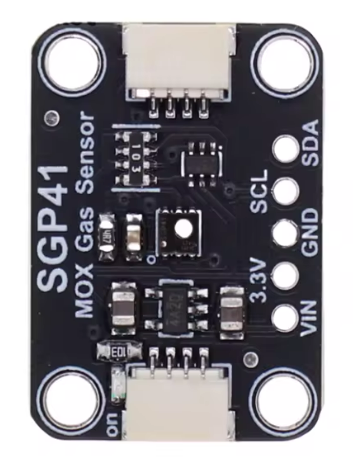
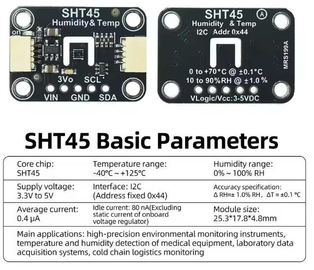
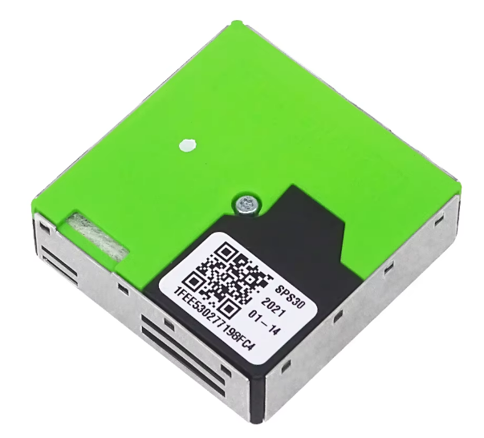
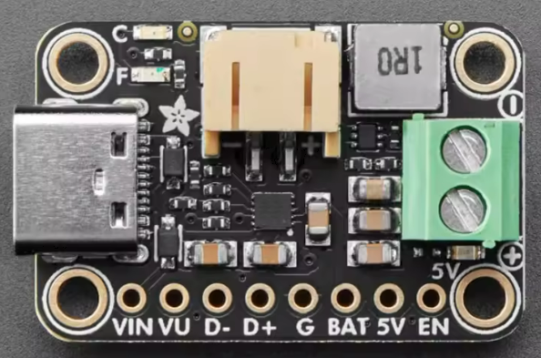
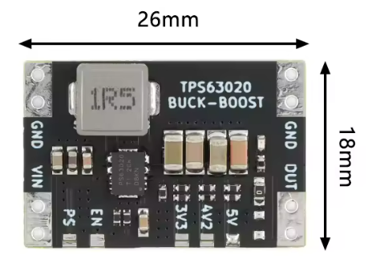
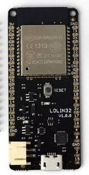

# Modular outdoor monitor

A DIY outdoor air-quality monitor wired from off-the-shelf modules, instead of the AirGradient Open Air main PCB in [`../open-air/`](../README.md). Two variants, one per MCU board. Both put every sensor on one I2C bus.

This schematic is new work in this fork. It is not a redraw of an AirGradient board. The firmware it targets is the AirGradient One Open Air sketch, which remains under CC BY-SA 4.0. These hardware notes are under the same license.

Revision **B**, 2026-11-25.

| Variant | Project | MCU |
| --- | --- | --- |
| A | [`variant-a-esp32-d1mini/modular-a.kicad_pro`](variant-a-esp32-d1mini/modular-a.kicad_pro) | WEMOS LOLIN32 Lite, ESP32-WROOM-32, micro-USB, JST LiPo. Photo 57.9 × 25.6 mm |
| B | [`variant-b-esp32s3-n16r8/modular-b.kicad_pro`](variant-b-esp32s3-n16r8/modular-b.kicad_pro) | ESP32-S3-WROOM-1 N16R8 on an AI-S3 / DevKitC-1 clone (16 MB quad flash, 8 MB octal PSRAM) |

Printable schematic, both sheets, landscape A4: [`schematic-modular-A4.pdf`](schematic-modular-A4.pdf).

Symbols are embedded in each `.kicad_sch`. There is no PCB. `hardware/modular/tools/gen_schematics.py` regenerates the sheets; the checked-in schematics are what KiCad ERC was run on.

## What the firmware in this change does

`pio run -e modular-lolin32-lite` (same flags as `modular-esp32-d1mini`) and `pio run -e modular-esp32s3-n16r8` select the pins below. The existing `esp32-c3` environment is unchanged.

Selecting an environment does three things in `examples/OneOpenAir/OneOpenAir.ino`:

- `Wire.begin` uses that variant's SDA/SCL, then `Wire.setClock(100000)` and a 200 ms clock-stretch timeout (SCD30 can stretch for up to 150 ms).
- `SPS30_5V_EN_PIN` is driven high at startup so the 5 V boost stays on. Drive it low later to remove power from the SPS30.
- `VBAT_ADC_PIN` is read with 11 dB attenuation. The log line multiplies the pin voltage by 2 for the 100 kΩ / 100 kΩ divider.

On these two environments the sketch probes I2C for a CO2 sensor and reads the SPS30 at 0x69. The ESP32-C3 build does not. Details are in the startup log: SCD30 at 0x61 (continuous, 2 s, ASC on), SCD41 at 0x62 (periodic, ASC on), or neither. If both answer, SCD41 is used and SCD30 is left idle. SHT stays the temperature source; CO2-sensor T/RH is used only when no SHT answers. `SPS30_ALWAYS_ON=1` (the default) leaves the 5 V boost on. Set it to 0 to drop the boost between readings; each cycle then waits `SPS30_STARTUP_MS` (8000, the datasheet's stable-sample time). The inherited UART probe still exists for the C3 board. On these MCUs that probe is `Serial2` and nothing on the harness should be wired to it.

| Board | `Serial2` default pins (Arduino-ESP32 2.0.17) | Leave unconnected |
| --- | --- | --- |
| Variant A, LOLIN32 Lite | RX GPIO16, TX GPIO17 | GPIO16, GPIO17 |
| Variant B, ESP32-S3 | RX GPIO19, TX GPIO20 | GPIO19, GPIO20 (these are also the native USB pins) |

The sketch still drives GPIO3, GPIO4 and GPIO5 while it looks for a cellular card. Do not wire those pins on either variant.

## Modules

AliExpress listing pages did not return usable HTML to this environment (they block non-browser clients). Pinouts and voltages below are from the manufacturer's datasheet or, for the charger, from the Adafruit 6106 Eagle schematic. Confirm the silkscreen on the board you actually received before soldering.

| Name | Function | Interface | I2C address | Voltage | Source used |
| --- | --- | --- | --- | --- | --- |
| WEMOS LOLIN32 Lite | Variant A controller. ESP32-WROOM-32, 57.9 × 25.6 mm on the photo. | GPIO, I2C, ADC1 | — | 3.3 V on the 3V pin | Arduino-ESP32 2.0.17 `variants/lolin32-lite/pins_arduino.h` and the photo `images/wemos-lolin32-lite.png`. |
| ESP32-S3 N16R8 (AI-S3) | Variant B controller. 16 MB quad SPI flash, 8 MB octal PSRAM. | GPIO, I2C, ADC1 | — | 3.3 V on the 3V3 pin | Espressif DevKitC-1 v1.1 user guide, YD-ESP32-S3 size note, and `images/esp32s3-n16r8.png`. |
| SGP41 module | VOC / NOx. Header VIN, 3.3V, GND, SCL, SDA. Adafruit 6455 outline 25.4 × 17.78 mm. | I2C | 0x59 | 3.3 V into VIN (breakout accepts 3–5 V) | Sensirion SGP41 datasheet and Adafruit 6455 Eagle. Listing [1005009523201465](https://pl.aliexpress.com/item/1005009523201465.html). |
| SCD30 module | CO2, plus its own T/RH. Fit this **or** the SCD41. 35 × 23 × 7 mm. Header VDD, GND, TX/SCL, RX/SDA, RDY, PWM, SEL. | I2C. `SEL` open or to GND. | 0x61 | 3.3 V (datasheet range 3.3–5.5 V; do not use 5 V here) | Sensirion SCD30 datasheet. Listing [1005012719322072](https://pl.aliexpress.com/item/1005012719322072.html). |
| SCD41 module | CO2. Fit this **or** the SCD30. Header, label side, left to right: GND, VCC, SCL, SDA. Board 13.4 × 21.6 mm. | I2C | 0x62 | 3.3 V (sensor 2.4–5.5 V, peak about 205 mA at 3.3 V) | Sensirion SCD4x datasheet and the module photo below. Listing [1005009897956849](https://pl.aliexpress.com/item/1005009897956849.html). |
| SHT45 module | Temperature / humidity. 25.3 × 17.8 × 4.8 mm. Header VIN, 3Vo, GND, SCL, SDA. Feed VIN from 3.3 V. 3Vo open. | I2C | 0x44 fixed | 3.3 V into VIN (seller allows 3.3–5 V; keep I2C at 3.3 V) | Seller card on `images/sht45.png` (marking MRS199A) and Sensirion SHT4x datasheet. Listing [1005012546290193](https://pl.aliexpress.com/item/1005012546290193.html). |
| SPS30 | Particulate matter. I2C mode. 41 × 41 × 12 mm (L × W × H). Header: VDD (5 V), SDA, SCL, SEL to GND, GND. | I2C, `SEL` to GND before power-up | 0x69 | 5 V ±10% on VDD. Logic is 3.3 V (VIH min 2.31 V). Max 100 kHz. | Photo `images/sps30.png` and Sensirion SPS30 datasheet v2.0 (June 2023). Listing [1005009874188645](https://pl.aliexpress.com/item/1005009874188645.html). |
| BQ25185 + 5 V boost | USB-C / solar charger and 5 V boost. Outline 29.21 × 19.05 mm. Header left to right: VIN, VU, D−, D+, G, BAT, 5V, EN. | Power. `EN` is active high. | — | Solar/DC on VIN, 3.6–18 V (abs. max 25 V, OVP about 18.5 V). Pack is 1S. Boost output 5 V. | Eagle outline of Adafruit 6106 and the photo `images/bq25185-5v-boost.png`. Listing [1005008650602873](https://pl.aliexpress.com/item/1005008650602873.html). |
| TPS63020 module | 3.3 V buck-boost, 26 × 18 mm. Left GND, VIN. Right GND, OUT. Bottom PS, EN, and 3V3/4V2/5V select pads. | Power. EN high (tied to VIN). PS low. | — | Input from VBAT. Bridge the 3V3 pad. TI input range 1.8–5.5 V. | Photo `images/tps63020.png` and TI TPS63020 datasheet SLVS916I. Listing [1005001949409346](https://pl.aliexpress.com/item/1005001949409346.html). |
| 1S pack | 2 or 3 18650 cells in parallel, one 1S protection circuit | Battery | — | 3.0–4.2 V | — |
| 10 kΩ NTC, β(25/85) = 3435 K | Cold/hot charge cutoff, body on the cells | Analog, charger `TS` to GND | — | — | BQ25185 TS bias is specified for this NTC |

## Photos and product pages

Every product-page URL and every photo URL below returned HTTP 200 when checked on 2026-11-25. Manufacturer and retailer images are hotlinked and are not copied into the repo. Photos of the modules in hand are stored under `images/`. Adafruit Learning System text is CC BY-SA; the shop JPEGs are only linked.

The AliExpress links are the purchase links from the original module list. The photos are of the official part or the closest official board, not of that exact AliExpress listing. Wemos does not sell a classic-ESP32 "D1 Mini"; the official ESP32-WROOM board in that family is the LOLIN D32, and the only image `wemos.cc` serves for it is a 16×16 thumbnail.

### SGP41

- This breakout: [`images/sgp41.png`](images/sgp41.png). Adafruit-style STEMMA QT clone. Header, with VIN at the bottom of the right-hand row in that photo and at the top of the schematic symbol: **VIN, 3.3V, GND, SCL, SDA**. Two 4-pin JST-SH connectors. Green LED marked `on`. A part marked 103 (10 kΩ) is the likely I2C pull-up pair.
- Adafruit's SGP41 board is product [6455](https://www.adafruit.com/product/6455), not 5839 (5839 is the OV5640 camera). The Eagle outline of [Adafruit SGP41 Gas Sensor Breakout rev A.brd](https://github.com/adafruit/Adafruit-SGP41-Gas-Sensor-Breakout-PCB/blob/main/Adafruit%20SGP41%20Gas%20Sensor%20Breakout%20rev%20A.brd), dimension layer, is **25.4 × 17.78 mm** (1.00 × 0.70 in). That is the reference size for this clone. The learn guide [pinouts](https://learn.adafruit.com/adafruit-sgp41-multi-pixel-gas-sensor-breakout/pinouts) page matches the header: VIN is the supply (same voltage as the logic, so 3.3 V here; the regulator also accepts 5 V), **3.3V is the regulator output and is left open**, SDA/SCL are level-shifted with 10 kΩ pull-ups, I2C address **0x59**.
- The chip does not compute an index. Sensirion's [SGP41 datasheet](https://sensirion.com/media/documents/5FE8673C/61E96F50/Sensirion_Gas_Sensors_Datasheet_SGP41.pdf) section 3.1 says to run `sgp41_execute_conditioning` for **10 s, and not longer than 10 s**, then feed the raw VOC and NOx ticks through the Gas Index Algorithm.
- Feed **VIN from 3.3 V** so the bus stays at 3.3 V. Do not tie the module's 3.3V pin to the rail.
- Sensor: [Sensirion SGP41](https://sensirion.com/products/catalog/SGP41). Photo: [webp](https://sensirion.com/media/portfolio/product/image/67113b8f-5ff8-4c9c-86bf-836bbd5cf902.webp).
- Purchase: [AliExpress 1005009523201465](https://pl.aliexpress.com/item/1005009523201465.html).



### SCD30

- This module: [`images/scd30.png`](images/scd30.png), photographed on a centimetre grid. Sensirion's SCD30 datasheet gives the module size as **35 × 23 × 7 mm**. The 7-pin header, in datasheet order, is **VDD, GND, TX/SCL, RX/SDA, RDY, PWM, SEL**. The schematic symbol lists that order top to bottom.
- Leave **SEL unconnected or tie it to GND** for I2C. Either one selects I2C at address **0x61**. The sheet ties SEL to GND so the mode cannot float. RDY and PWM are no-connect. Supply range is 3.3–5.5 V; this monitor feeds VDD from 3.3 V. Keep I2C at **100 kHz or below**. 100 kHz is already the default on both modular environments. The SCD30 clock-stretches, which is why the Wire timeout is 200 ms.
- Sensor: [Sensirion SCD30](https://sensirion.com/products/catalog/SCD30). Photo: [webp](https://sensirion.com/media/portfolio/product/image/4b4053f1-f7ef-43d2-bfe0-b2f00cfe34ba.webp).
- Breakout of a different carrier: [Adafruit 4867](https://www.adafruit.com/product/4867). Photo: [JPEG](https://cdn-shop.adafruit.com/970x728/4867-07.jpg).
- Purchase: [AliExpress 1005012719322072](https://pl.aliexpress.com/item/1005012719322072.html).


### SCD41

- Sensor: [Sensirion SCD41](https://sensirion.com/products/catalog/SCD41). Photo: [webp](https://sensirion.com/media/portfolio/product/image/0dbb13dc-abee-4dbf-a0d0-68cc881b5486.webp).
- Breakout: [Adafruit 5190](https://www.adafruit.com/product/5190). Photo: [JPEG](https://cdn-shop.adafruit.com/970x728/5190-06.jpg).
- Purchase: [AliExpress 1005009897956849](https://pl.aliexpress.com/item/1005009897956849.html).
- This module, measured from the photo below: PCB 13.4 × 21.6 mm. Header, left to right on the label side: **GND, VCC, SCL, SDA**. R1 and R2 are marked 103 (10 kΩ) and are the likely I2C pull-ups. C1 is the local bypass. U1 is the SCD41. The schematic symbol lists those four pins in that order, top to bottom.


### SHT45

- This breakout (marking MRS199A): [`images/sht45.png`](images/sht45.png). Seller card on that image: 25.3 × 17.8 × 4.8 mm; supply 3.3–5 V with an onboard regulator; VLogic/Vcc 3–5 V; I2C address fixed at 0x44; accuracy ±1.0 %RH and ±0.1 °C; range −40 to +125 °C and 0–100 %RH; idle 80 nA excluding the regulator (the card also lists 0.4 µA average). Pins, in header order: **VIN, 3Vo, GND, SCL, SDA**, plus two 4-pin JST-SH (STEMMA QT / Qwiic) connectors.
- Feed **VIN from 3.3 V**. The I2C pull-ups follow that logic supply. 5 V on VIN can put 5 V on SDA/SCL. Leave **3Vo** open. It is the regulator output; do not tie it to the 3.3 V rail.
- Sensor: [Sensirion SHT45](https://sensirion.com/products/catalog/SHT45). Photo: [webp](https://sensirion.com/media/portfolio/series/image/07fb657d-331a-4652-b79f-0240926500f1.webp).
- Same sensor on an Adafruit carrier: [Adafruit 5665](https://www.adafruit.com/product/5665). Photo: [JPEG](https://cdn-shop.adafruit.com/970x728/5665-01.jpg).
- Purchase: [AliExpress 1005012546290193](https://pl.aliexpress.com/item/1005012546290193.html).



### SPS30

- This module: [`images/sps30.png`](images/sps30.png). 41 × 41 × 12 mm (L × W × H). Five-pin header: **VDD (5 V), SDA, SCL, SEL (tie to GND for I2C), GND**.
- Sensor: [Sensirion SPS30](https://sensirion.com/products/catalog/SPS30).
- Purchase: [AliExpress 1005009874188645](https://pl.aliexpress.com/item/1005009874188645.html).



### BQ25185 charger with 5 V boost

- This board: [`images/bq25185-5v-boost.png`](images/bq25185-5v-boost.png). USB-C, JST-PH battery, LEDs C (charge) and F (fault). Header, left to right: **VIN, VU, D−, D+, G, BAT, 5V, EN**. The green screw terminal is the 5 V boost output (silkscreen "5V"). Solar or DC goes to **VIN**, not into that terminal.
- Outline size, measured from the Eagle board file [Adafruit bq25185 with 5V Boost Breakout.brd](https://github.com/adafruit/Adafruit-bq25185-with-5V-Boost-PCB/blob/main/Adafruit%20bq25185%20with%205V%20Boost%20Breakout.brd) on layer Dimension (layer 20): the outline runs from (0, 0) to (29.21 mm, 19.05 mm), with the corners chamfered. 29.21 mm is 1.15 in and 19.05 mm is 0.75 in. The coordinates are millimeters (2.54 mm segments are 0.1 in). The product page and learn guide do not print a separate size.
- Official board: [Adafruit 6106](https://www.adafruit.com/product/6106). Learn guide: [bq25185 USB / DC / Solar Charger with 5V Boost](https://learn.adafruit.com/adafruit-bq25185-usb-dc-solar-charger-with-5v-boost-board). Shop photo: [JPEG](https://cdn-shop.adafruit.com/970x728/6106-00.jpg).
- Purchase (clone): [AliExpress 1005008650602873](https://pl.aliexpress.com/item/1005008650602873.html).



### TPS63020 3.3 V buck-boost

- This module: [`images/tps63020.png`](images/tps63020.png). The print on the photo is **26 mm × 18 mm**. Left edge, top to bottom: **GND, VIN**. Right edge: **GND, OUT**. Bottom pads: **PS**, **EN**, then solder-bridge pads **3V3 / 4V2 / 5V**.
- Close only the **3V3** bridge. The module is sold as 3.3 V, and these boards pick the output by shorting one of those three pads into the feedback divider. Confirm the 3V3 pad is the one soldered, then measure OUT before it touches the ESP32. Do not bridge 4V2 or 5V as well.
- TI TPS63020 datasheet SLVS916I (pin table and section 7.4.4): **EN** high enables the converter and low shuts it down. EN must not be left open. These modules usually pull EN up, so an open pad is already on; the sheet ties EN to VIN. **PS/SYNC** low enables power-save, which the converter enters when the average inductor current falls below about 100 mA. PS/SYNC high forces PWM. The sheet ties PS to GND. PS/SYNC must not be left open either.
- Chip and EVM, for the datasheet photo rather than this module: [TPS63020](https://www.ti.com/product/TPS63020), [TPS63020EVM-487](https://www.ti.com/tool/TPS63020EVM-487). Photo: [EVM](https://dam.ti.com/transform/80b8c8ec-af00-4c47-9283-63e1bb9eab2d/TPS63020EVM-487-Angled).
- Purchase: [AliExpress 1005001949409346](https://pl.aliexpress.com/item/1005001949409346.html).



### WEMOS LOLIN32 Lite

This is the variant A board. Wemos retired the Lite; the pin map used here is the Arduino `lolin32-lite` variant plus the [DONE.LAND pinout](https://done.land/components/microcontroller/families/esp/esp32/developmentboards/esp32s/lolin32lite/). The photo below is the board in hand, 57.9 × 25.6 mm.

- Purchase class: [AliExpress 1005008273255710](https://pl.aliexpress.com/item/1005008273255710.html).



### ESP32-S3-DevKitC-1 N16R8

- This board: [`images/esp32s3-n16r8.png`](images/esp32s3-n16r8.png). Purple AI-S3, two USB-C ports labelled COM and USB, RGB LED on GPIO48.
- Espressif board: [ESP32-S3-DevKitC-1](https://www.espressif.com/en/products/devkits/esp32-s3-devkitc-1). Guide: [v1.1 user guide](https://docs.espressif.com/projects/esp-dev-kits/en/latest/esp32s3/esp32-s3-devkitc-1/user_guide_v1.1.html). Photo: [isometric PNG](https://docs.espressif.com/projects/esp-dev-kits/en/latest/esp32s3/_images/esp32-s3-devkitc-1-v1.1-isometric.png).
- Clone size: [YD-ESP32-S3, 57.15 × 27.94 mm](https://www.espboards.dev/esp32/yd-esp32-s3/).
- Purchase: [AliExpress 1005004617322170](https://pl.aliexpress.com/item/1005004617322170.html).


## Wiring

Shared nets on both sheets: `SDA`, `SCL`, `+3V3`, `ESP_3V3` (the ESP32 side of JP1), `GND`, `VBAT`, `+5V_SPS`, `VIN_SOLAR`, `BOOST_EN`, `SPS_EN`, `VBAT_SENSE`, `TS`.

I2C pull-ups are **R4 and R5, 4.7 kΩ, to +3V3, and they are fitted.** Decision:

- The SPS30 datasheet requires external pull-ups (their example is 10 kΩ) and the sensor has none.
- The SCD30's only pull-ups are internal 45 kΩ to its own 3 V rail. That is too weak to be the only pull-up on a cabled bus, and it is not a 5 V pull-up. Powering the SCD30 from 3.3 V keeps the bus at 3.3 V. Do not power it from 5 V.
- SGP41, SCD41 and SHT45 bare sensors also require external pull-ups. The breakout you receive may already have 4.7–10 kΩ. A 4.7 kΩ pair in parallel with one extra 10 kΩ pair is still about 3.2 kΩ, above the roughly 1 kΩ floor for a 3 mA sink at 3.3 V. The SCD41 carrier in `images/scd41.png` has R1 and R2 marked 103 (10 kΩ), and the SGP41 photo shows a 103 as well. Adafruit's SGP41 guide also fits 10 kΩ. Those sit in parallel with R4 and R5. That is fine. If you measure the idle bus and the equivalent is under about 2 kΩ, remove either the schematic pair or the module pair.
- Never pull SDA or SCL up to 5 V.

Bus speed is 100 kHz. That is the SPS30 maximum and the SCD30 maximum. Sensirion recommends 50 kHz or less for the SCD30; this revision follows the 100 kHz spec and relies on clock stretching. Keep cables short. Sensirion suggests well under 10 cm for SPS30 on I2C.

`JP1` is in series with the 3.3 V feed to the ESP32 `3V3` pin.

- Fit JP1 for battery operation.
- Remove JP1 before plugging a USB cable into the ESP32 board.
- Do not power the board from USB and from the 3V3 pin at the same time. The onboard regulator and the TPS63020 will fight.
- Do not connect `+5V_SPS` to the ESP32 `5V` / VBUS pin. That 5 V rail is only for the SPS30.

### Variant A — `modular-lolin32-lite` (and `modular-esp32-d1mini`)

The board in the photo is sold as a WeMos D1 ESP32 and is a **WEMOS LOLIN32 Lite**: ESP32-WROOM-32, micro-USB, onboard LiPo charger, 2-pin JST PH battery socket. The print on [`images/wemos-lolin32-lite.png`](images/wemos-lolin32-lite.png) is **57.9 × 25.6 mm**. That is longer than the retired bare-chip Lite (often quoted near 49–50 × 25 mm) because this one carries a WROOM module. PlatformIO board is `lolin32_lite`. `modular-esp32-d1mini` is the same environment under the old name.

Reference pinout: Arduino-ESP32 2.0.17 [`variants/lolin32-lite/pins_arduino.h`](https://github.com/espressif/arduino-esp32/blob/2.0.17/variants/lolin32-lite/pins_arduino.h) sets `SDA = 19`, `SCL = 23`, `LED_BUILTIN = 22`, `A0 = 36`. A written pin list that matches this header is [DONE.LAND — Lolin32 Lite](https://done.land/components/microcontroller/families/esp/esp32/developmentboards/esp32s/lolin32lite/). GPIO21 is not on that header, so the old D1 Mini map (SDA 21, SCL 22) does not fit.

Checked against that header:

| Signal | On the Lite header? | Choice |
| --- | --- | --- |
| GPIO21 | No | Not used. |
| GPIO22 | Yes, and it is the blue LED (on when the pin is low) | Not used for I2C. |
| GPIO19 | Yes | **SDA** |
| GPIO23 | Yes | **SCL** |
| GPIO26 | Yes (in the 25–27 group) | **SPS30 5 V enable**, active high |
| GPIO36 / VP | Yes, input only | **VBAT ADC**, ADC1 channel 0 |

Strapping pins GPIO0, GPIO2, GPIO12 and GPIO15 stay open. Input-only GPIO34, GPIO35 and GPIO39 stay open. GPIO36 is the one input-only pin we use, and only as an ADC.

| Signal | GPIO | Silkscreen | Notes |
| --- | --- | --- | --- |
| I2C SDA | 19 | 19 | Arduino `SDA` for `lolin32-lite` |
| I2C SCL | 23 | 23 | Arduino `SCL`. GPIO22 is the LED, so it is not the clock. |
| SPS30 5 V enable | 26 | 26 | Active high. Series 1 kΩ (R3) to the boost `EN`. |
| VBAT ADC | 36 | VP | ADC1 channel 0, input only. 11 dB attenuation. |
| ESP32 3V3 | — | 3V | From JP1 / TPS63020. Not from USB at the same time. |
| GND | — | GND | Common ground. |

The Lite has **no 5 V pin** and **no battery divider**. The 100 kΩ / 100 kΩ divider on the sheet is required. `A0` in this variant is GPIO36 with no onboard divider.

**Onboard charger.** The Lite charges a 1S pack from micro-USB through its own charger (the reference board uses a TP4054-class part, about 500 mA) and the JST socket. That charger has no solar input and no 5 V boost. Decision for this monitor:

- **Keep the BQ25185 module** when the box has a solar or DC input. It is also the only 5 V boost for the SPS30. Do **not** connect the same cell to the Lite JST and to the BQ25185. Two chargers on one pack is not safe. Leave the Lite JST empty and do not plug the Lite's micro-USB in while JP1 feeds 3.3 V into the 3V pin.
- **The Lite charger can replace the BQ25185 only if there is no solar panel.** Charge from the Lite's micro-USB and JST, and still add a separate 5 V boost from the pack for the SPS30. The sheet does not draw that second boost; the drawn 5 V source is the BQ module. The external divider to GPIO36 stays either way.

Build flags: `-D I2C_SDA_PIN=19 -D I2C_SCL_PIN=23 -D SPS30_5V_EN_PIN=26 -D VBAT_ADC_PIN=36 -D I2C_CLOCK_HZ=100000 -D WIRE_TIMEOUT_MS=200 -D VBAT_DIVIDER_NUM=2 -D VBAT_DIVIDER_DEN=1`.

### Variant B — `modular-esp32s3-n16r8`

PlatformIO board `esp32-s3-devkitc-1` with `board_build.arduino.memory_type = qio_opi`, quad flash mode, `board_build.psram_type = opi`, 16 MB flash size, and `-DBOARD_HAS_PSRAM`. The linked SDK in a successful build is the `qio_opi` package, which matches Espressif's N16R8 description: 16 MB **quad** SPI flash and 8 MB **octal** SPI PSRAM (not octal flash). GPIO8 and GPIO9 are this variant's default Wire pins.

The partition table is the existing 4 MB `partitions.csv`, so the OTA layout stays the same and the upper 12 MB of flash is unused. The stock board json is still titled "DevKitC-1-N8 (No PSRAM)"; the memory settings above override that.

| Signal | GPIO | DevKitC-1 silkscreen | Notes |
| --- | --- | --- | --- |
| I2C SDA | 8 | IO8 | Default `SDA` |
| I2C SCL | 9 | IO9 | Default `SCL` |
| SPS30 5 V enable | 7 | IO7 | Active high. GPIO10 is this variant's default SPI SS, so the enable is not on GPIO10. |
| VBAT ADC | 6 | IO6 | ADC1 channel 5. Usable while Wi-Fi is on. |
| ESP32 3V3 | — | 3V3 | From JP1 / TPS63020. |
| ESP32 5V | — | 5V | No connect. |
| GND | — | GND | Common ground. |

Do not use, on an N16R8:

- GPIO33, GPIO34, GPIO35, GPIO36, GPIO37. Espressif's DevKitC-1 v1.1 guide says GPIO35–37 are taken by octal SPI flash/PSRAM. The octal PSRAM data lines also use GPIO33–34, so those are left unused too.
- GPIO0, GPIO3, GPIO45, GPIO46 (strapping). GPIO45 must stay low at boot on a 3.3 V flash part.
- GPIO43 / GPIO44 (UART0, the COM port) and GPIO19 / GPIO20 (native USB, and also this firmware's `Serial2` probe).
- GPIO48, the RGB LED.

The board in [`images/esp32s3-n16r8.png`](images/esp32s3-n16r8.png) is a purple AI-S3 DevKitC-1 clone with an ESP32-S3-WROOM-1 marked N16R8, two USB-C sockets, RST and BOOT, and an RGB LED. The silkscreen labels include **6, 7, 8 and 9**, so the four signals in the table are on the header. GPIO35, GPIO36 and GPIO37 are also labelled, and they stay unconnected: on N16R8 they belong to the octal PSRAM. Strapping pins GPIO0, GPIO3, GPIO45 and GPIO46 are not used. GPIO48 is the onboard RGB LED (WS2812). Some clones only connect that LED after an `RGB` solder bridge is closed; either way, do not use GPIO48 for a sensor.

Published size for this YD-ESP32-S3 / DevKitC-style clone is **57.15 × 27.94 mm** ([espboards.dev YD-ESP32-S3](https://www.espboards.dev/esp32/yd-esp32-s3/)). A shop listing of the same shape says about 57 × 28 mm. The photo has no scale, so that cited figure is the one to use. It is a bit shorter and wider than a 63 × 25.5 mm guess.

Flash and the serial log use the **COM** USB-C port (the UART bridge). The port marked **USB** is native USB-OTG. USB CDC on boot is left off, so a cable in the USB socket will not show `Serial`. A board with only the native USB connector needs `-D ARDUINO_USB_CDC_ON_BOOT=1`.

Build flags: `-D I2C_SDA_PIN=8 -D I2C_SCL_PIN=9 -D SPS30_5V_EN_PIN=7 -D VBAT_ADC_PIN=6` plus the same clock, timeout and divider macros as variant A.

## Power

```
USB-C on the charger module ──┐
                               ├── BQ25185 ── BAT ── 1S pack (2–3× 18650 parallel, protected)
Solar / DC on VIN ────────────┘     │
                                    ├── VBAT ── TPS63020 EN+VIN ── 3.3 V ── JP1 ── ESP32 3V3 and all 3.3 V sensors
                                    └── internal SYS ── TPS61023 ── +5V_SPS ── SPS30 VDD
                                              EN ← GPIO, active high, 1 kΩ series
```

Adafruit's 6106 schematic (the file `Adafruit bq25185 with 5V Boost Breakout.sch` in their GitHub repo) was used as the clone's pinout:

- The 8-pin header brings out VIN, VBUS, D−, D+, GND, VBAT, +5V and EN. **SYS is not on the header.** The TPS61023 input is SYS, inside the module. The TPS63020 is therefore fed from **VBAT**, the pin that is actually available. A missing or protection-open cell means the 3.3 V rail does not run, even if USB is plugged into the charger. The 5 V boost can still run, because it is powered from SYS internally.
- `EN` has a 100 kΩ pull-up to SYS (about 3.0 V on battery, about 4.5 V when an input is present). TPS61023 enables above 1.2 V and shuts off below about 0.4 V. R3 (1 kΩ) lets a 3.3 V GPIO override that pull-up. While the GPIO is high-Z at reset, the 100 kΩ pulls EN up and the SPS30 powers on; the injected current into the ESP32 pin is under about 20 µA. Do not replace R3 with a short.
- `TS/MR` is tied to GND through a fitted 10 kΩ (R16 on the Adafruit board) and is **not** on the header. That fixed resistor holds the pin at the nominal point and disables the temperature cutoff. For a cold-charge cutoff, remove that 10 kΩ and wire RT1 from the TS pad to GND, with the thermistor body on the cells. A clone that copies this board has the same limitation unless its silkscreen shows a TS/TH pin.
- Charge current on the Adafruit board defaults to 1 A, which is fine for two or three parallel 18650s. Adafruit documents a 6 hour safety timer that is not removable. A deeply discharged 3-cell parallel pack at 1 A may not finish in one session.
- `/CE` is tied so charging is enabled. Leave it that way.

TI's electrical table does not publish the cutoff in °C. With the 38 µA TS bias (`ITSMR`), VCOLD ≈ 1.01 V and VHOT ≈ 0.115 V, a 10 kΩ β=3435 NTC is roughly 2 °C at the cold entry and roughly 60 °C at the hot entry. That is a calculation from those three numbers, not a line in the datasheet. A fixed 10 kΩ from TS to GND disables both cutoffs.

Solar open-circuit voltage should stay under 18 V. The charger's operating range goes to 18 V and it trips input OVP around 18.5 V (absolute maximum on IN is 25 V). A "6 V" panel (Voc typically under 12 V) fits. A "12 V" panel must be checked for Voc.

SPS30 supply current from the same datasheet: measurement 45–65 mA, fan start at most 80 mA for the first 200 ms. That is under the TPS61023's roughly 200 mA hard-start limit that Adafruit warns about. Enable the boost with the sensor idle, then start a measurement.

The battery divider is R1 = R2 = 100 kΩ from VBAT to GND, with C1 = 100 nF from the midpoint to GND. Pin voltage is half the pack voltage, so 4.2 V becomes 2.1 V, inside the ESP32 ADC range at 11 dB. The reading is approximate; the ESP32 ADC is not linear.

Bridge the TPS63020 **3V3** pad only, and measure OUT before it touches the ESP32. EN is tied to VBAT (enable high; the datasheet says the pin must not float). PS is tied to GND so light-load power-save stays available. Do not also drive EN from a GPIO.

## Connectors

Wire the SCD30 in datasheet order: VDD, GND, TX/SCL, RX/SDA, RDY, PWM, SEL. The symbol lists that order top to bottom and ties SEL to GND. Leaving SEL open also selects I2C. RDY and PWM are no-connect. Keep the bus at 100 kHz or slower.

The SGP41 block follows the STEMMA QT header: VIN (from 3.3 V), 3.3V (open), GND, SCL, SDA. The SHT45 block is VIN (from 3.3 V), 3Vo (open), GND, SCL, SDA. The SCD41 block follows the photographed carrier: GND, VCC, SCL, SDA. Do not feed 5 V into an SGP41 pin that goes straight to the sensor. The SHT45 sensor itself is also limited to 3.6 V; its carrier has a regulator, and VIN is still held at 3.3 V so the I2C lines stay at 3.3 V.

SPS30 mating plug is a JST ZHR-5. Pin order from the datasheet, looking at the connector with pin 1 at the end Sensirion marks: 1 VDD (5 V), 2 SDA, 3 SCL, 4 SEL (to GND), 5 GND. SEL must be low at the moment power is applied. The metal shell is connected to pin 5 inside the sensor; don't let the shell sit at a different potential than GND.

## ERC

KiCad 9.0.9 `kicad-cli sch erc` on both projects: 0 errors, 0 warnings. The project file sets `lib_symbol_issues` to ignore, because every symbol is embedded in the sheet and the `Modular` / `Device` / `power` nicknames are not in the global library table. Re-run with:

```
kicad-cli sch erc --severity-error --severity-warning hardware/modular/variant-a-esp32-d1mini/modular-a.kicad_sch
kicad-cli sch erc --severity-error --severity-warning hardware/modular/variant-b-esp32s3-n16r8/modular-b.kicad_sch
```

## Build

From the repository root, with PlatformIO and `espressif32@6.13.0` (Arduino-ESP32 2.0.17, same pin as the ESP32-C3 environment):

```
pio run -e modular-lolin32-lite
pio run -e modular-esp32-d1mini
pio run -e modular-esp32s3-n16r8
pio run -e esp32-c3
```

A build on 2026-11-25, after `git submodule update --init --recursive`. Variant A is the LOLIN32 Lite (`lolin32_lite`). `modular-esp32-d1mini` is the same build under the previous environment name.

| Environment | Result | RAM | Flash |
| --- | --- | --- | --- |
| `modular-lolin32-lite` | success | 78540 / 327680 bytes (24.0%) | 1793489 / 1966080 bytes (91.2%) |
| `modular-esp32-d1mini` | success | 78540 / 327680 bytes (24.0%) | 1793489 / 1966080 bytes (91.2%) |
| `modular-esp32s3-n16r8` | success | 73960 / 327680 bytes (22.6% of internal SRAM; the 8 MB PSRAM is not in this number) | 1684061 / 1966080 bytes (85.7%) |
| `esp32-c3` (unchanged environment, rebuilt as a check) | success | 68844 / 327680 bytes (21.0%) | 1781418 / 1966080 bytes (90.6%) |

Those modular numbers are with `AG_MODULAR_I2C` (SCD30/SCD41 auto-detect and SPS30 over I2C). The C3 image is the same size as before that flag.

The S3 image was linked against the `qio_opi` SDK libraries and `esptool` was invoked with `--flash_size 16MB`. The app partition is still the 4 MB Open Air slot (`0x1E0000` bytes), which is why the flash percentage is against 1.9 MB rather than 16 MB.
