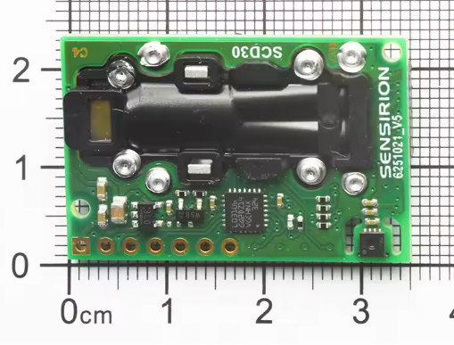
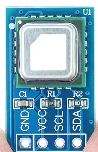
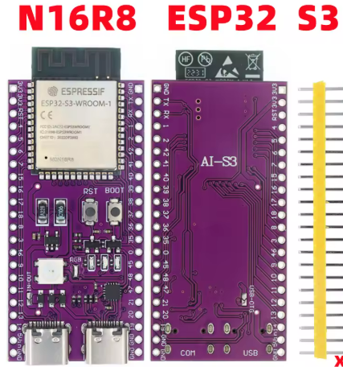

# Modular outdoor monitor

A DIY outdoor air-quality monitor wired from off-the-shelf modules, instead of the AirGradient Open Air main PCB in [`../open-air/`](../README.md). Two variants, one per MCU board. Both put every sensor on one I2C bus.

This schematic is new work in this fork. It is not a redraw of an AirGradient board. The firmware it targets is the AirGradient One Open Air sketch, which remains under CC BY-SA 4.0. These hardware notes are under the same license.

Revision **D**, 2026-11-27. The dev board is powered from its USB connector, or from an M8 panel plug when USB is unplugged. Its 5 V pin feeds the SPS30. Its 3.3 V pin feeds every 3.3 V module. M8 pins 2 and 4 are sense inputs (battery and solar). They do not power the board.

| Variant | Project | MCU |
| --- | --- | --- |
| A | [`variant-a-esp32-d1mini/modular-a.kicad_pro`](variant-a-esp32-d1mini/modular-a.kicad_pro) | WEMOS LOLIN32 V1.0.0 (micro-USB) or an ESP32 D1 mini. Same I2C and ADC1 pins. USB, or M8 5 V when USB is unplugged. Leave the LOLIN32 battery socket empty. |
| B | [`variant-b-esp32s3-n16r8/modular-b.kicad_pro`](variant-b-esp32s3-n16r8/modular-b.kicad_pro) | ESP32-S3-WROOM-1 N16R8 on an AI-S3 / DevKitC-1 clone (16 MB quad flash, 8 MB octal PSRAM). USB, or M8 5 V when USB is unplugged. |

Printable schematic, both sheets, landscape A4: [`schematic-modular-A4.pdf`](schematic-modular-A4.pdf).

Symbols are embedded in each `.kicad_sch`. There is no PCB. `hardware/modular/tools/gen_schematics.py` regenerates the sheets; the checked-in schematics are what KiCad ERC was run on.

## What the firmware in this change does

`pio run -e modular-lolin32` (same flags as `modular-esp32-d1mini` and `modular-lolin32-lite`) and `pio run -e modular-esp32s3-n16r8` select the pins below. The existing `esp32-c3` environment is unchanged.

Selecting an environment does two things in `examples/OneOpenAir/OneOpenAir.ino`:

- `Wire.begin` uses that variant's SDA/SCL, then `Wire.setClock(100000)` and a 200 ms clock-stretch timeout (SCD30 can stretch for up to 150 ms).
- `SPS30_ALWAYS_ON=1` keeps the SPS30 measurement running. VDD is wired to the dev-board 5 V pin, so the sensor is powered whenever that pin is powered (USB, or M8 5 V through D1). The modular envs do not define `SPS30_5V_EN_PIN`.
- `VBAT_ADC_PIN`, `VSOL_ADC_PIN` and `USB_PRESENT_ADC_PIN` read the M8 sense dividers. `printMeasurements` already runs every 6 s, and the new sample uses that same call. `analogReadMilliVolts` applies the `esp_adc_cal` curve at 11 dB, 12-bit, averaged over 16 samples after one discarded conversion. While the USB-present divider is at or above 1200 mV, both readings are forced to 0. Sensor intervals are otherwise unchanged: SCD30 at 2 s, SCD41 on the library's periodic measurement.
- The local JSON endpoint and the MQTT payload (`measurements.toString` with the local-server flag) gain `vbat` and `vsol` in millivolts, plus `usb` as 0 or 1. The cloud post does not grow those keys. A build without the three pins omits them.

On these environments the sketch probes I2C for a CO2 sensor and reads the SPS30 at 0x69. The ESP32-C3 build does not. Details are in the startup log: SCD30 at 0x61 (continuous, 2 s, ASC on), SCD41 at 0x62 (periodic, ASC on), or neither. If both answer, SCD41 is used and SCD30 is left idle. SHT stays the temperature source; CO2-sensor T/RH is used only when no SHT answers. The inherited UART probe still exists for the C3 board. On these MCUs that probe is `Serial2` and nothing on the harness should be wired to it.

| Board | `Serial2` default pins (Arduino-ESP32 2.0.17) | Leave unconnected |
| --- | --- | --- |
| Variant A, LOLIN32 V1.0.0 | RX GPIO16, TX GPIO17 | GPIO16, GPIO17 |
| Variant B, ESP32-S3 | RX GPIO19, TX GPIO20 | GPIO19, GPIO20 (these are also the native USB pins) |

The sketch still drives GPIO3, GPIO4 and GPIO5 while it looks for a cellular card. Do not wire those pins on either variant.

## Modules

AliExpress listing pages did not return usable HTML to this environment (they block non-browser clients). Pinouts and voltages below are from the manufacturer's datasheet or the board pinout cited in the row. Confirm the silkscreen on the board you actually received before soldering.

Rev D does not fit a BQ25185 charger, a TPS63020 buck-boost, a 1S3P pack, or a battery NTC. M8 pin 4 senses a solar voltage. It does not harvest it. M8 pin 2 senses a battery. It does not charge it. The LOLIN32 PH-2 socket stays empty.

| Name | Function | Interface | I2C address | Voltage | Source used |
| --- | --- | --- | --- | --- | --- |
| WEMOS LOLIN32 V1.0.0 | Variant A controller. ESP32-WROOM-32. 58 × 25.4 mm (earlier photo print 57.9 × 25.6 mm). Powered from its micro-USB. | GPIO, I2C | — | USB in. Header **5V** is VBUS out. Header **3V3** is the ME6211 output. | Archived Wemos LOLIN32 page, [espboards.dev LOLIN32](https://www.espboards.dev/esp32/lolin32/), and `images/wemos-lolin32.png`. |
| ESP32 D1 mini | Same firmware image as the LOLIN32 (`modular-esp32-d1mini`). GPIO21 SDA, GPIO22 SCL. | GPIO, I2C | — | USB in. Silkscreen **5V** (some boards print **5V0**) is VBUS. Silkscreen **3V3** (some print **3.3V**) is the regulator output. | [espboards.dev D1 mini ESP32](https://www.espboards.dev/esp32/d1-mini32/). |
| ESP32-S3 N16R8 (AI-S3) | Variant B controller. 16 MB quad SPI flash, 8 MB octal PSRAM. Board 57.15 × 27.94 mm. Powered from its USB connector. | GPIO, I2C | — | USB in. Silkscreen **5V** is VBUS (about 4.6 V after the DevKitC-1 Schottky). Silkscreen **3V3** is the onboard LDO. | [YD-ESP32-S3 size](https://www.espboards.dev/esp32/yd-esp32-s3/), Espressif DevKitC-1 v1.1 schematic, and `images/esp32s3-n16r8.png`. |
| SGP41 module | VOC / NOx. Header VIN, 3.3V, GND, SCL, SDA. Adafruit 6455 outline 25.4 × 17.78 mm. | I2C | 0x59 | 3.3 V into VIN (breakout accepts 3–5 V) | Photo `images/sgp41.png`, Sensirion SGP41 datasheet, and Adafruit 6455 Eagle. Listing [1005009523201465](https://pl.aliexpress.com/item/1005009523201465.html). |
| SCD30 module | CO2, plus its own T/RH. Fit this **or** the SCD41. 35 × 23 × 7 mm. Header VDD, GND, TX/SCL, RX/SDA, RDY, PWM, SEL. | I2C. `SEL` open or to GND. | 0x61 | 3.3 V (datasheet range 3.3–5.5 V; do not use 5 V here) | Photo `images/scd30.png` and Sensirion SCD30 datasheet. Listing [1005012719322072](https://pl.aliexpress.com/item/1005012719322072.html). |
| SCD41 module | CO2. Fit this **or** the SCD30. Header, label side, left to right: GND, VCC, SCL, SDA. Board 13.4 × 21.6 mm. | I2C | 0x62 | 3.3 V (sensor 2.4–5.5 V, peak about 205 mA at 3.3 V) | Photo `images/scd41.png` and Sensirion SCD4x datasheet. Listing [1005009897956849](https://pl.aliexpress.com/item/1005009897956849.html). |
| SHT45 module | Temperature / humidity. 25.3 × 17.8 × 4.8 mm. Header VIN, 3Vo, GND, SCL, SDA. Feed VIN from 3.3 V. 3Vo open. | I2C | 0x44 fixed | 3.3 V into VIN (seller allows 3.3–5 V; keep I2C at 3.3 V) | Seller card on `images/sht45.png` (marking MRS199A) and Sensirion SHT4x datasheet. Listing [1005012546290193](https://pl.aliexpress.com/item/1005012546290193.html). |
| SPS30 | Particulate matter. I2C mode. 41 × 41 × 12 mm (L × W × H). Header: VDD (5 V), SDA, SCL, SEL to GND, GND. | I2C, `SEL` to GND before power-up | 0x69 | 5 V ±10% on VDD, taken from the dev-board 5 V pin. Logic is 3.3 V (VIH min 2.31 V). Max 100 kHz. | Photo `images/sps30.png` and Sensirion SPS30 datasheet v2.0 (June 2023). Listing [1005009874188645](https://pl.aliexpress.com/item/1005009874188645.html). |
| R1, R2 | I2C pull-ups, 4.7 kΩ, from SDA and SCL to +3V3. | — | — | 3.3 V | Fitted on the sheet. See Wiring. |
| J1 | M8 A-coded 4-pin panel connector. Pin 1 brown +5 V, pin 2 white VBAT, pin 3 blue GND, pin 4 black VSOL. | Power and sense | — | See the pinout table | IEC 61076-2-101 / IEC 60947-5-2 colours. |
| F1 | PTC, Bourns MF-R110 or equivalent. Hold 1.1 A, trip 2.2 A. In series with M8 pin 1. | — | — | 5 V | Radial, 30 V class. |
| D1 | Schottky 1N5822, anode toward M8, cathode toward the dev-board 5 V pin. | — | — | 5 V | 40 V, 3 A. OR-ing diode. See Power. |
| D2 | TVS P6KE6.8A, cathode on M8 5 V after F1, anode to GND. | — | — | Standoff 5.8 V | Unidirectional. |
| D3, R10, R11, C10 | VBAT sense. D3 P6KE6.8A at the pin. R10 1.00 MΩ series/top, R11 1.00 MΩ to GND, C10 100 nF at the ADC pin. | ADC1 | — | 2.7–4.6 V at the pin | Divider ratio 2. |
| D4, R12, R13, C11 | VSOL sense. D4 P6KE30A at the pin. R12 1.80 MΩ series/top, R13 200 kΩ to GND, C11 100 nF at the ADC pin. | ADC1 | — | 5–22 V at the pin | Divider ratio 10. |
| J2, R14, R15, C12 | USB-present divider. Variant A: R14 100 kΩ from the USB-jack VBUS tap, R15 150 kΩ to GND, C12 100 nF. | ADC1 | — | USB VBUS | See USB detect. Variant B adds J3 and R16. |

## Photos and product pages

Every product-page URL and every photo URL below returned HTTP 200 when checked on 2026-11-25. Manufacturer and retailer images are hotlinked and are not copied into the repo. Photos of the modules in hand are stored under `images/`. Adafruit Learning System text is CC BY-SA; the shop JPEGs are only linked.

The AliExpress links are the purchase links from the original module list. The photos are of the official part or the closest official board, not of that exact AliExpress listing. Wemos does not sell a classic-ESP32 "D1 Mini"; the official ESP32-WROOM board in that family is the LOLIN D32, and the only image `wemos.cc` serves for it is a 16×16 thumbnail.

### SGP41

- This breakout: [`images/sgp41.png`](images/sgp41.png). Adafruit-style STEMMA QT clone. Header, with VIN at the bottom of the right-hand row in that photo and at the top of the schematic symbol: **VIN, 3.3V, GND, SCL, SDA**. Two 4-pin JST-SH connectors. Green LED marked `on`. A part marked 103 (10 kΩ) is the likely I2C pull-up pair.
- Adafruit's SGP41 board is product [6455](https://www.adafruit.com/product/6455), not 5839 (5839 is the OV5640 camera). The Eagle outline of [Adafruit SGP41 Gas Sensor Breakout rev A.brd](https://github.com/adafruit/Adafruit-SGP41-Gas-Sensor-Breakout-PCB/blob/main/Adafruit%20SGP41%20Gas%20Sensor%20Breakout%20rev%20A.brd), dimension layer, is **25.4 × 17.78 mm** (1.00 × 0.70 in). That is the reference size for this clone. The learn guide [pinouts](https://learn.adafruit.com/adafruit-sgp41-multi-pixel-gas-sensor-breakout/pinouts) page matches the header: VIN is the supply (same voltage as the logic, so 3.3 V here; the regulator also accepts 5 V), **3.3V is the regulator output and is left open**, SDA/SCL are level-shifted with 10 kΩ pull-ups, I2C address **0x59**.
- The chip does not compute an index. Sensirion's [SGP41 datasheet](https://sensirion.com/media/documents/5FE8673C/61E96F50/Sensirion_Gas_Sensors_Datasheet_SGP41.pdf) section 3.1 says to run `sgp41_execute_conditioning` for **10 s, and not longer than 10 s**, then feed the raw VOC and NOx ticks through the Gas Index Algorithm.
- Feed **VIN from 3.3 V** so the bus stays at 3.3 V. Do not tie the module's 3.3V pin to the rail.
- Sensor: [Sensirion SGP41](https://sensirion.com/products/catalog/SGP41). Photo: [webp](https://sensirion.com/media/portfolio/product/image/67113b8f-5ff8-4c9c-86bf-836bbd5cf902.webp).
- Purchase: [AliExpress 1005009523201465](https://pl.aliexpress.com/item/1005009523201465.html).


### SCD30

- This module: [`images/scd30.png`](images/scd30.png), photographed on a centimetre grid. Sensirion's SCD30 datasheet gives the module size as **35 × 23 × 7 mm**. The 7-pin header, in datasheet order, is **VDD, GND, TX/SCL, RX/SDA, RDY, PWM, SEL**. The schematic symbol lists that order top to bottom.
- Leave **SEL unconnected or tie it to GND** for I2C. Either one selects I2C at address **0x61**. The sheet ties SEL to GND so the mode cannot float. RDY and PWM are no-connect. Supply range is 3.3–5.5 V; this monitor feeds VDD from 3.3 V. Keep I2C at **100 kHz or below**. 100 kHz is already the default on both modular environments. The SCD30 clock-stretches, which is why the Wire timeout is 200 ms.
- Sensor: [Sensirion SCD30](https://sensirion.com/products/catalog/SCD30). Photo: [webp](https://sensirion.com/media/portfolio/product/image/4b4053f1-f7ef-43d2-bfe0-b2f00cfe34ba.webp).
- Breakout of a different carrier: [Adafruit 4867](https://www.adafruit.com/product/4867). Photo: [JPEG](https://cdn-shop.adafruit.com/970x728/4867-07.jpg).
- Purchase: [AliExpress 1005012719322072](https://pl.aliexpress.com/item/1005012719322072.html).



### SCD41

- Sensor: [Sensirion SCD41](https://sensirion.com/products/catalog/SCD41). Photo: [webp](https://sensirion.com/media/portfolio/product/image/0dbb13dc-abee-4dbf-a0d0-68cc881b5486.webp).
- Breakout: [Adafruit 5190](https://www.adafruit.com/product/5190). Photo: [JPEG](https://cdn-shop.adafruit.com/970x728/5190-06.jpg).
- Purchase: [AliExpress 1005009897956849](https://pl.aliexpress.com/item/1005009897956849.html).
- This module, measured from the photo below: PCB 13.4 × 21.6 mm. Header, left to right on the label side: **GND, VCC, SCL, SDA**. R1 and R2 are marked 103 (10 kΩ) and are the likely I2C pull-ups. C1 is the local bypass. U1 is the SCD41. The schematic symbol lists those four pins in that order, top to bottom.




### SHT45

- This breakout (marking MRS199A): [`images/sht45.png`](images/sht45.png). Seller card on that image: 25.3 × 17.8 × 4.8 mm; supply 3.3–5 V with an onboard regulator; VLogic/Vcc 3–5 V; I2C address fixed at 0x44; accuracy ±1.0 %RH and ±0.1 °C; range −40 to +125 °C and 0–100 %RH; idle 80 nA excluding the regulator (the card also lists 0.4 µA average). Pins, in header order: **VIN, 3Vo, GND, SCL, SDA**, plus two 4-pin JST-SH (STEMMA QT / Qwiic) connectors.
- Feed **VIN from 3.3 V**. The I2C pull-ups follow that logic supply. 5 V on VIN can put 5 V on SDA/SCL. Leave **3Vo** open. It is the regulator output; do not tie it to the 3.3 V rail.
- Sensor: [Sensirion SHT45](https://sensirion.com/products/catalog/SHT45). Photo: [webp](https://sensirion.com/media/portfolio/series/image/07fb657d-331a-4652-b79f-0240926500f1.webp).
- Same sensor on an Adafruit carrier: [Adafruit 5665](https://www.adafruit.com/product/5665). Photo: [JPEG](https://cdn-shop.adafruit.com/970x728/5665-01.jpg).
- Purchase: [AliExpress 1005012546290193](https://pl.aliexpress.com/item/1005012546290193.html).


### SPS30

- This module: [`images/sps30.png`](images/sps30.png). 41 × 41 × 12 mm (L × W × H). Five-pin header: **VDD (5 V), SDA, SCL, SEL (tie to GND for I2C), GND**.
- Sensor: [Sensirion SPS30](https://sensirion.com/products/catalog/SPS30).
- Purchase: [AliExpress 1005009874188645](https://pl.aliexpress.com/item/1005009874188645.html).


### WEMOS LOLIN32 V1.0.0

This is the variant A board the photo shows. Silkscreen reads LOLIN32 V1.0.0. ESP32-WROOM-32, micro-USB, a PH-2 battery socket, an onboard charger, a CHG LED, and a RESET button. The archived [Wemos LOLIN32 page](https://web.archive.org/web/20181114100348/wiki.wemos.cc/products:lolin32:lolin32) lists **58 × 25.4 mm** and a 500 mA charge current. An earlier marked photo of this board printed 57.9 × 25.6 mm, which is the same outline within about a millimetre. The photo below has no scale.

This monitor does not use the PH-2 socket or the onboard charger. Leave the socket empty. Power the board from its micro-USB connector, or from M8 pins 1 and 3 into the silkscreen 5V pin when USB is unplugged. The header 5V pin is already after the CJ2301 + BCM857 ideal diode, so a supply on that pin does not flow back into the USB jack.

- Pinout drawing: [espboards.dev LOLIN32](https://www.espboards.dev/esp32/lolin32/).
- Purchase class: [AliExpress 1005008273255710](https://pl.aliexpress.com/item/1005008273255710.html).


### ESP32 D1 mini

`modular-esp32-d1mini` builds the same image as `modular-lolin32` (PlatformIO board `lolin32`, SDA GPIO21, SCL GPIO22). A physical ESP32 D1 mini brings those two GPIOs out as well, and its power pins are silkscreen **5V** (some prints **5V0**) and **3V3** (some prints **3.3V**). [espboards.dev](https://www.espboards.dev/esp32/d1-mini32/) draws pin 39 as `5V` / `5V0` ("5V from the USB connector") and pin 33 as `3V3` / `3.3V` ("3.3V power output from the on-board regulator"). Wemos-style boards use an ME6211-class regulator. Many clones fit an AMS1117-3.3 instead. Read the package on the board you have before trusting the current budget below.

### ESP32-S3-DevKitC-1 N16R8

- This board: [`images/esp32s3-n16r8.png`](images/esp32s3-n16r8.png). Purple AI-S3, two USB-C ports labelled COM and USB, RGB LED on GPIO48.
- Espressif board: [ESP32-S3-DevKitC-1](https://www.espressif.com/en/products/devkits/esp32-s3-devkitc-1). Guide: [v1.1 user guide](https://docs.espressif.com/projects/esp-dev-kits/en/latest/esp32s3/esp32-s3-devkitc-1/user_guide_v1.1.html). Photo: [isometric PNG](https://docs.espressif.com/projects/esp-dev-kits/en/latest/esp32s3/_images/esp32-s3-devkitc-1-v1.1-isometric.png).
- Clone size: [YD-ESP32-S3, 57.15 × 27.94 mm](https://www.espboards.dev/esp32/yd-esp32-s3/).
- Purchase: [AliExpress 1005004617322170](https://pl.aliexpress.com/item/1005004617322170.html).




## Wiring

Shared nets on both sheets: `SDA`, `SCL`, `+3V3`, `+5V_SPS`, `GND`, plus the M8 sense nets `VBAT`, `VSOL`, `A_VBAT`, `A_VSOL`, `USBDET`.

```
USB jack on the dev board                         J1 M8 pin 1 (+5 V)
        │                                                │
        │  (onboard diode, see Power)                    F1 MF-R110
        │                                                │
        └── header 5V  ◄──── D1 1N5822 (cathode) ────────┤ M8_5V, D2 P6KE6.8A to GND
                    │
                    ├── +5V_SPS ── SPS30 VDD
                    │
                    └── onboard 3.3 V LDO ── header 3V3 ── +3V3 ── SCD30 or SCD41, SGP41, SHT45, R1, R2
```

USB and M8 5 V both feed the dev-board 5 V pin. D1 keeps the header from feeding back out of the M8, and it keeps M8 from paralleling the header. Do not feed the 3V3 pin from another regulator. Do not put a cell in the LOLIN32 PH-2 socket. M8 pins 2 and 4 do not power anything.

I2C pull-ups are **R1 and R2, 4.7 kΩ, to +3V3, and they are fitted.**

- The SPS30 datasheet requires external pull-ups (their example is 10 kΩ) and the sensor has none.
- The SCD30's only pull-ups are internal 45 kΩ to its own 3 V rail. That is too weak to be the only pull-up on a cabled bus, and it is not a 5 V pull-up. Powering the SCD30 from 3.3 V keeps the bus at 3.3 V. Do not power it from 5 V.
- SGP41, SCD41 and SHT45 bare sensors also require external pull-ups. The breakout you receive may already have 4.7–10 kΩ. A 4.7 kΩ pair in parallel with one extra 10 kΩ pair is still about 3.2 kΩ, above the roughly 1 kΩ floor for a 3 mA sink at 3.3 V. The SCD41 carrier in `images/scd41.png` has two resistors marked 103 (10 kΩ), and the SGP41 photo shows a 103 as well. Adafruit's SGP41 guide also fits 10 kΩ. Those sit in parallel with R1 and R2. That is fine. If you measure the idle bus and the equivalent is under about 2 kΩ, remove either the schematic pair or the module pair.
- Never pull SDA or SCL up to 5 V.

Bus speed is 100 kHz. That is the SPS30 maximum and the SCD30 maximum. Sensirion recommends 50 kHz or less for the SCD30; this revision follows the 100 kHz spec and relies on clock stretching. Keep cables short. Sensirion suggests well under 10 cm for SPS30 on I2C.

### Power pins

SPS30 VDD goes to the dev board's 5 V header pin. Every 3.3 V module and R1/R2 go to the 3.3 V header pin. GND is common.

| Board | 5 V pin, to SPS30 VDD and to D1's cathode | 3.3 V pin, to the I2C modules and R1/R2 |
| --- | --- | --- |
| WEMOS LOLIN32 V1.0.0 | Silkscreen **5V**. [espboards.dev](https://www.espboards.dev/esp32/lolin32/) calls this pin `5V` / `VUSB`: USB VBUS through the CJ2301 + BCM857 ideal-diode switch. External 5 V on this pin does not reach the USB jack. While USB is plugged in the pin is an output near 5 V, which is why D1 is still fitted. | Silkscreen **3V3** (the header repeats it). Output of the onboard ME6211. |
| ESP32 D1 mini | Silkscreen **5V**, or **5V0**. Treat it as USB VBUS unless a meter says otherwise. See the D1 mini note under Power. | Silkscreen **3V3**, or **3.3V**. Output of the onboard regulator. |
| ESP32-S3 N16R8 (DevKitC-1 / AI-S3) | Silkscreen **5V**. On the official DevKitC-1 v1.1 schematic this net is `VCC_5V` after a 1N5819 from each USB jack, about 4.6 V when USB powered. External 5 V on this pin does not reach either USB jack. D1 is still fitted so USB cannot exit the M8. | Silkscreen **3V3**. Output of the onboard LDO. |

### Variant A — `modular-lolin32` (also `modular-esp32-d1mini` and `modular-lolin32-lite`)

The board in [`images/wemos-lolin32.png`](images/wemos-lolin32.png) is a **WEMOS LOLIN32 V1.0.0**. PlatformIO board is `lolin32`. The two older environment names build the same flags, which also match an ESP32 D1 mini's GPIO21/GPIO22 and its 5V/3V3 pins.

Arduino-ESP32 2.0.17 [`variants/lolin32/pins_arduino.h`](https://github.com/espressif/arduino-esp32/blob/2.0.17/variants/lolin32/pins_arduino.h) sets `SDA = 21`, `SCL = 22`, `LED_BUILTIN = 5`, `A0 = 36`. The [LOLIN32 pinout](https://www.espboards.dev/esp32/lolin32/) shows GPIO21 and GPIO22 on the header, and the user LED on GPIO5, active low (on when the pin is low). GPIO5 is also a strapping pin and must be high at boot, which is the LED-off state. It is not used for I2C.

| Signal | GPIO | Silkscreen | Notes |
| --- | --- | --- | --- |
| I2C SDA | 21 | 21 | Arduino `SDA` for `lolin32`. Same pin on the ESP32 D1 mini. |
| I2C SCL | 22 | 22 | Arduino `SCL`. Same pin on the ESP32 D1 mini. |
| VBAT ADC | 34 | 34 | ADC1_CH6, input only. After R10/R11. Same pin on the D1 mini. |
| VSOL ADC | 35 | 35 | ADC1_CH7, input only. After R12/R13. Same pin on the D1 mini. |
| USB present | 32 | 32 | ADC1_CH4. Divider from USB-jack VBUS. Same pin on the D1 mini. |
| 5 V to SPS30 | — | 5V | Dev-board 5 V pin, after D1 when the supply is the M8. |
| 3.3 V to I2C modules | — | 3V3 | Onboard LDO output. Do not back-feed this pin. |
| GND | — | GND | Common ground, including M8 pin 3. |
| User LED | 5 | 5 | Active low. The cellular probe also drives GPIO5, so this LED can blink during that probe. |

GPIO34 and GPIO35 are input-only ADC1 pins. They are not boot-strap pins. espboards marks them "strapping" because they cannot drive a pin, not because they are sampled at reset. GPIO32 is a normal ADC1 input. None of the three is GPIO0, GPIO2, GPIO5, GPIO12 or GPIO15.

Leave open: GPIO0, GPIO2, GPIO12 and GPIO15 (strapping), GPIO1/TX, GPIO3/RX, GPIO4, GPIO16/17 (this firmware's `Serial2` probe), GPIO26, GPIO36/VP, GPIO39, and the flash pins GPIO6–11. The LOLIN32 PH-2 battery socket stays empty. The CHG LED is the unused onboard charger's indicator, not the GPIO5 user LED.

`modular-lolin32`, `modular-esp32-d1mini` and `modular-lolin32-lite` are one image. The D1 mini header brings out GPIO32, GPIO34 and GPIO35 as well as GPIO21 and GPIO22, so the same pins are used on both boards. `modular-lolin32-lite` is that same image; it is not a separate Lite-board pin map.

Build flags: `-D I2C_SDA_PIN=21 -D I2C_SCL_PIN=22 -D I2C_CLOCK_HZ=100000 -D WIRE_TIMEOUT_MS=200 -D SPS30_ALWAYS_ON=1 -D VBAT_ADC_PIN=34 -D VSOL_ADC_PIN=35 -D USB_PRESENT_ADC_PIN=32 -D VBAT_DIVIDER_NUM=2 -D VBAT_DIVIDER_DEN=1 -D VSOL_DIVIDER_NUM=10 -D VSOL_DIVIDER_DEN=1 -D USB_PRESENT_THRESHOLD_MV=1200`.

### Variant B — `modular-esp32s3-n16r8`

PlatformIO board `esp32-s3-devkitc-1` with `board_build.arduino.memory_type = qio_opi`, quad flash mode, `board_build.psram_type = opi`, 16 MB flash size, and `-DBOARD_HAS_PSRAM`. The linked SDK in a successful build is the `qio_opi` package, which matches Espressif's N16R8 description: 16 MB **quad** SPI flash and 8 MB **octal** SPI PSRAM (not octal flash). GPIO8 and GPIO9 are this variant's default Wire pins.

The partition table is the existing 4 MB `partitions.csv`, so the OTA layout stays the same and the upper 12 MB of flash is unused. The stock board json is still titled "DevKitC-1-N8 (No PSRAM)"; the memory settings above override that.

| Signal | GPIO | DevKitC-1 silkscreen | Notes |
| --- | --- | --- | --- |
| I2C SDA | 8 | IO8 | Default `SDA` |
| I2C SCL | 9 | IO9 | Default `SCL` |
| VBAT ADC | 6 | IO6 | ADC1_CH5. Free on N16R8. After R10/R11. |
| VSOL ADC | 7 | IO7 | ADC1_CH6. Free on N16R8. After R12/R13. |
| USB present | 10 | IO10 | ADC1_CH9. Divider from both USB-jack VBUS pads. |
| 5 V to SPS30 | — | 5V | Dev-board 5 V pin, after D1 when the supply is the M8. |
| 3.3 V to I2C modules | — | 3V3 | Onboard LDO output. Do not back-feed this pin. |
| GND | — | G | Common ground, including M8 pin 3. |

ESP32-S3 ADC1 is GPIO1–GPIO10. ADC2 is GPIO11–GPIO20 and is not used, because Wi-Fi claims it. 11 dB attenuation on the S3 is still about 0–3.1 V in Arduino-ESP32 2.0.17 (`ADC_11db`). The operating points below sit near 2.2–2.3 V.

Do not use, on an N16R8:

- GPIO33, GPIO34, GPIO35, GPIO36, GPIO37. Espressif's DevKitC-1 v1.1 guide says GPIO35–37 are taken by octal SPI flash/PSRAM. The octal PSRAM data lines also use GPIO33–34, so those are left unused too.
- GPIO0, GPIO3, GPIO45, GPIO46 (strapping). GPIO45 must stay low at boot on a 3.3 V flash part. GPIO3, GPIO4 and GPIO5 are also driven by the cellular probe.
- GPIO43 / GPIO44 (UART0, the COM port) and GPIO19 / GPIO20 (native USB, and also this firmware's `Serial2` probe).
- GPIO48, the RGB LED.

The board in [`images/esp32s3-n16r8.png`](images/esp32s3-n16r8.png) is a purple AI-S3 DevKitC-1 clone with an ESP32-S3-WROOM-1 marked N16R8, two USB-C sockets, RST and BOOT, and an RGB LED. The silkscreen labels include **8 and 9**, which are SDA and SCL, and **6 and 7**, which are VBAT and VSOL. GPIO10 is the USB-present input. GPIO35, GPIO36 and GPIO37 stay unconnected: on N16R8 they belong to the octal PSRAM. Strapping pins GPIO0, GPIO3, GPIO45 and GPIO46 are not used. GPIO48 is the onboard RGB LED (WS2812). Some clones only connect that LED after an `RGB` solder bridge is closed; either way, do not use GPIO48 for a sensor.

Published size for this YD-ESP32-S3 / DevKitC-style clone is **57.15 × 27.94 mm** ([espboards.dev YD-ESP32-S3](https://www.espboards.dev/esp32/yd-esp32-s3/)). A shop listing of the same shape says about 57 × 28 mm. The photo has no scale, so that cited figure is the one to use. It is a bit shorter and wider than a 63 × 25.5 mm guess.

Flash and the serial log use the **COM** USB-C port (the UART bridge). The port marked **USB** is native USB-OTG. Either port can feed VBUS. USB CDC on boot is left off, so a cable in the USB socket will not show `Serial`. A board with only the native USB connector needs `-D ARDUINO_USB_CDC_ON_BOOT=1`.

Build flags: `-D I2C_SDA_PIN=8 -D I2C_SCL_PIN=9 -D I2C_CLOCK_HZ=100000 -D WIRE_TIMEOUT_MS=200 -D SPS30_ALWAYS_ON=1 -D VBAT_ADC_PIN=6 -D VSOL_ADC_PIN=7 -D USB_PRESENT_ADC_PIN=10 -D VBAT_DIVIDER_NUM=2 -D VBAT_DIVIDER_DEN=1 -D VSOL_DIVIDER_NUM=10 -D VSOL_DIVIDER_DEN=1 -D USB_PRESENT_THRESHOLD_MV=1200`.

## M8 pinout

J1 is an M8 A-coded 4-pin panel connector (IEC 61076-2-101). Colours are the IEC 60947-5-2 assignment. Pins 1 and 3 are the power pair. Pins 2 and 4 are sense only.

| Pin | Colour | Signal | Range | Notes |
| --- | --- | --- | --- | --- |
| 1 | Brown | +5 V in | 5.0–5.5 V at the connector | Through F1, D2 and D1 into the dev-board 5 V pin. Powers the board when USB is unplugged. |
| 2 | White | VBAT | 2.7–4.6 V | Sense. Divider R10/R11. Does not charge and does not run the board. |
| 3 | Blue | GND | 0 V | Common with the dev board and every module. |
| 4 | Black | VSOL | 5–22 V | Sense, with margin to 25 V. Divider R12/R13. Not a power input. |

## Dividers

Both dividers use 11 dB attenuation. The usable window is about 0–3.1 V on the ESP32 and on the ESP32-S3 in Arduino-ESP32 2.0.17. The top resistor is the series protection resistor. A 100 nF capacitor sits on the ADC pin. Divider current is a few microamps.

| Input | Parts | Ratio | At the top of the range | At the design margin | ADC pin |
| --- | --- | --- | --- | --- | --- |
| VBAT | R10 1.00 MΩ, R11 1.00 MΩ, C10 100 nF, D3 P6KE6.8A | 2.00 | 4.6 V → 2.30 V | 6.2 V → 3.10 V | Variant A GPIO34, variant B GPIO6 |
| VSOL | R12 1.80 MΩ, R13 200 kΩ, C11 100 nF, D4 P6KE30A | 10.00 | 22 V → 2.20 V | 25 V → 2.50 V, 31 V → 3.10 V | Variant A GPIO35, variant B GPIO7 |

P6KE6.8A stands off 5.8 V, so it does not conduct at 4.6 V or at a 5.25 V supply. P6KE30A stands off 25.6 V, so a 25 V solar reading is not clamped. If the TVS does clamp, the megaohm series resistor holds the current into the ESP32 pin's clamp to about 20 µA.

Firmware: `millivolts = analogReadMilliVolts(pin) * NUM / DEN`, with NUM/DEN = 2/1 and 10/1. Sixteen samples are averaged after one discarded reading. The sample runs from `printMeasurements`, which is already scheduled every 6 s.

## USB present

The firmware reports 0 mV for VBAT and 0 mV for VSOL while USB is connected, even if the M8 sense wires are still live. The detector is a divider from **USB-jack VBUS, on the USB side of the board's diode**, not from the 5 V header. The 5 V header is high for both USB and M8, so it cannot tell them apart.

`analogReadMilliVolts` on the detect pin is compared with 1200 mV. No internal pull is enabled. The bottom resistor holds the pin low when the jack is unplugged or the tap wire is open.

| Board | Tap | Divider | 5 V on one port | Threshold |
| --- | --- | --- | --- | --- |
| Variant A, one USB jack | J2, soldered to the jack VBUS pad | R14 100 kΩ, R15 150 kΩ, C12 100 nF | 5.0 V → 3.00 V. 5.5 V → 3.30 V. | 1200 mV on GPIO32 |
| Variant B, COM and native USB | J2 on the COM jack, J3 on the native USB jack, each before that jack's Schottky | R14 200 kΩ, R16 200 kΩ, R15 100 kΩ, C12 100 nF | One port at 4.75 V → 1.58 V. Both ports at 5.25 V → 2.63 V. Both at 5.5 V → 2.75 V. | 1200 mV on GPIO10 |

### Where VBUS actually is

- **LOLIN32.** The silkscreen 5V pin is after Q1 (CJ2301), which the BCM857 steers as an ideal diode. Solder J2 to micro-USB pin 1 (VBUS), or to the USB-side pin of that MOSFET. Do not solder it to the 5V header.
- **ESP32-S3 DevKitC-1 v1.1.** Each USB jack has its own 1N5819 (D1 from the UART jack, D7 from the native USB jack) into `VCC_5V`, which is the 5V header. There is no header pin for raw VBUS. Solder J2 and J3 to the two jack VBUS pads, on the jack side of those Schottkys. The AI-S3 photo board has the same two sockets (COM and USB). Confirm with a meter that the 5V pin is not a dead short to either jack; if it is, use the D1 mini mod below on each shorted jack before trusting J2/J3.
- **ESP32 D1 mini.** There is no single schematic. Many clones copy the ESP8266 D1 mini and put a Schottky between the USB jack and the 5V pin (cathode at the pin). Others tie the 5V pin straight to USB VBUS. With USB unplugged, a diode test from the 5V pin back to the jack VBUS pad should conduct in only one direction. If it reads about 0 Ω both ways, the pin **is** VBUS: M8 power injected there appears on the USB receptacle, and a VBUS tap on that same node reads high whenever M8 is powering the board, so the firmware would report VBAT and VSOL as 0 all the time. Fit a 1N5819 or 1N5822 on the board, anode toward the USB jack and cathode toward the 5V header (lift the short first), then tap J2 on the jack side of that diode. D1 on the harness does not replace this mod, because it is on the other side of the short.

## Power

Two supplies can run the monitor. USB is the one that makes the firmware report zeros for the sense pins. M8 pins 1 and 3 run it the rest of the time. A linear regulator on the dev board makes 3.3 V from the 5 V pin.

- **5 V pin.** USB VBUS after the board's diode, or M8 5 V after D1. This pin powers the SPS30. It also feeds the onboard 3.3 V regulator.
- **3.3 V pin.** The regulator output. It already feeds the ESP32 module. The I2C sensors and the pull-ups share whatever current is left.

D1 is a 1N5822. At a few hundred milliamps its forward drop is about 0.3 V, so a 5.0 V M8 source lands near 4.7 V on the 5 V pin, inside the SPS30's 4.5–5.5 V window if the lead is short. Feed M8 pin 1 from 5.0–5.5 V. If the 5 V pin measures under 4.6 V while the SPS30 fan is running, replace D1 with a P-channel ideal diode of the same kind as the LOLIN32 switch (CJ2301 drain at M8_5V, source at the 5 V pin, BCM857BS gate comparator). A Schottky is the fitted part because it does not briefly short the two sources while a MOSFET gate is still charging. F1 (hold 1.1 A) and D2 sit on M8_5V so a miswire toward the solar lead trips the PTC instead of holding the TVS in breakdown.

### 3.3 V pin, shared with the ESP32

Sensirion currents, at the intervals this firmware already uses (SCD30 at 2 s, SCD41 on the library's default periodic measurement, which is 5 s):

| Load on the 3.3 V rail | Current |
| --- | --- |
| SCD30, if fitted | about 19 mA average at a 2 s interval, **75 mA peak** |
| SCD41, if fitted instead of the SCD30 | about 15 mA average at a 5 s interval, **205 mA peak** |
| SGP41 heater | a few milliamps, about 3 mA typical and under 5 mA |
| SHT45 | tiny: well under 1 mA during a conversion, nanoamps when idle |
| R1 / R2, 4.7 kΩ | about 0.7 mA on a line while it is driven low |

ESP32 Wi-Fi is the large term, and it is on the same regulator as the sensors:

- ESP32-WROOM-32 (LOLIN32 and the D1 mini): Wi-Fi transmit is about **240 mA** typical at 19.5 dBm, 802.11b, 1 Mbps (Espressif ESP32 datasheet). Espressif's hardware design guidelines ask the 3.3 V supply to be able to deliver **500 mA**, because peaks during transmit and RF calibration are higher than that typical.
- ESP32-S3 (variant B): Wi-Fi transmit is about **340 mA** typical.

Regulator ratings are for the whole rail, including the module:

- **LOLIN32.** The 3V3 pin is the ME6211 output. That regulator's maximum output current is **500 mA**. A Wi-Fi typical of 240 mA plus an SCD30 peak of 75 mA plus the SGP41 (under 5 mA) is about 320 mA if those peaks overlap, inside 500 mA, with little spare if the chip's own spike reaches the 500 mA guideline at the same moment. An SCD41 peak of 205 mA plus a 240 mA transmit is about 445 mA before that extra spike, so an SCD41 on this board sits on the regulator's limit. Average current is comfortable: receive is well below the transmit figure, and the SCD30 average is about 19 mA.
- **ESP32 D1 mini.** Wemos-style boards use the same ME6211 class (500 mA datasheet, less in practice on a small board with little copper). Many clones fit an AMS1117-3.3, rated about 1 A, with about 1.1 V of dropout, so a diode-dropped USB rail near 4.6 V leaves the regulator little headroom and it runs hot. Treat 500 mA as the budget unless you have identified the fitted part.
- **ESP32-S3-DevKitC-1 v1.1.** The schematic fits an SGM2212-3.3, **800 mA**. 340 mA of transmit plus a 75 mA SCD30 peak fits. 340 mA plus a 205 mA SCD41 peak is about 545 mA, still inside 800 mA. The AI-S3 clone may use a different regulator; read the package marking if the 3V3 rail sags.

### 5 V pin, SPS30 only

The SPS30 datasheet (v2.0) allows VDD of 4.5–5.5 V. Supply current is 45–65 mA while measuring, and at most **80 mA** for about the first 200 ms while the fan starts. That current comes from the 5 V pin, not from the 3.3 V regulator.

USB current is approximately the 3.3 V rail current (a linear regulator passes the load current through) plus the SPS30. An SCD30 build at the overlap above is about 320 mA on 3.3 V plus 80 mA, about 400 mA from USB, inside a 500 mA port. An SCD41 peak plus Wi-Fi transmit plus the fan start can pass 500 mA (about 445 mA on a LOLIN32's 3.3 V rail, plus 80 mA). Use a port that can supply that, or expect a brown-out. The LOLIN32's 5V pin stays near 5 V (ideal-diode switch). The official DevKitC-1 5V pin is about 4.6 V after its Schottky, which is inside the SPS30's 4.5 V minimum only if the cable drop is small.

## Connectors

Wire the SCD30 in datasheet order: VDD, GND, TX/SCL, RX/SDA, RDY, PWM, SEL. The symbol lists that order top to bottom and ties SEL to GND. Leaving SEL open also selects I2C. RDY and PWM are no-connect. Keep the bus at 100 kHz or slower.

The SGP41 block follows the STEMMA QT header: VIN (from 3.3 V), 3.3V (open), GND, SCL, SDA. The SHT45 block is VIN (from 3.3 V), 3Vo (open), GND, SCL, SDA. The SCD41 block follows the photographed carrier: GND, VCC, SCL, SDA. Do not feed 5 V into an SGP41 pin that goes straight to the sensor. The SHT45 sensor itself is also limited to 3.6 V; its carrier has a regulator, and VIN is still held at 3.3 V so the I2C lines stay at 3.3 V.

SPS30 mating plug is a JST ZHR-5. Pin order from the datasheet, looking at the connector with pin 1 at the end Sensirion marks: 1 VDD (5 V), 2 SDA, 3 SCL, 4 SEL (to GND), 5 GND. SEL must be low at the moment power is applied. The metal shell is connected to pin 5 inside the sensor; don't let the shell sit at a different potential than GND.

## ERC

KiCad 9.0.9 `kicad-cli sch erc` on both projects, re-run 2026-11-27 for rev D: 0 errors, 0 warnings. The project file sets `lib_symbol_issues` to ignore, because every symbol is embedded in the sheet and the `Modular` / `Device` / `power` nicknames are not in the global library table. Re-run with:

```
kicad-cli sch erc --severity-error --severity-warning hardware/modular/variant-a-esp32-d1mini/modular-a.kicad_sch
kicad-cli sch erc --severity-error --severity-warning hardware/modular/variant-b-esp32s3-n16r8/modular-b.kicad_sch
```

## Build

From the repository root, with PlatformIO and `espressif32@6.13.0` (Arduino-ESP32 2.0.17, same pin as the ESP32-C3 environment):

```
pio run -e modular-lolin32
pio run -e modular-esp32-d1mini
pio run -e modular-lolin32-lite
pio run -e modular-esp32s3-n16r8
pio run -e esp32-c3
```

A build on 2026-11-27, rev D. Variant A is the LOLIN32 image (`lolin32`). `modular-esp32-d1mini` uses the same flags, including the ADC pins. `modular-lolin32-lite` extends that env and was not rebuilt separately.

| Environment | Result | RAM | Flash |
| --- | --- | --- | --- |
| `modular-lolin32` | success | 78548 / 327680 bytes (24.0%) | 1793869 / 1966080 bytes (91.2%) |
| `modular-esp32-d1mini` | success | 78548 / 327680 bytes (24.0%) | 1793933 / 1966080 bytes (91.2%) |
| `modular-esp32s3-n16r8` | success | 73976 / 327680 bytes (22.6% of internal SRAM; the 8 MB PSRAM is not in this number) | 1684509 / 1966080 bytes (85.7%) |

Those numbers are with `AG_MODULAR_I2C` (SCD30/SCD41 auto-detect and SPS30 over I2C), `VBAT_ADC_PIN`, `VSOL_ADC_PIN` and `USB_PRESENT_ADC_PIN`. The two variant A rows use the same flags on board `lolin32`. Their flash totals differ because the environment name is compiled into file paths. The `esp32-c3` environment was not changed and was not rebuilt.

The S3 image was linked against the `qio_opi` SDK libraries and `esptool` was invoked with `--flash_size 16MB`. The app partition is still the 4 MB Open Air slot (`0x1E0000` bytes), which is why the flash percentage is against 1.9 MB rather than 16 MB.

## Enclosure

The enclosure that matches this revision is the original Open Air cover and base with a new carrier, in [`enclosure/`](enclosure/README.md). The older battery shells in that folder are not this design.
