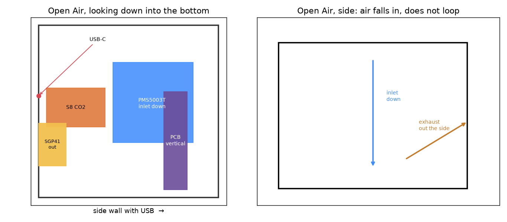

# Modular outdoor enclosure

Three ways to put the modular monitor inside a shell that keeps the AirGradient outdoor look: a rounded rectangular body, a bottom particulate screen, and a USB opening on the side. The models are parametric OpenSCAD, not a boolean edit of the original meshes. The original STLs were measured and the new shell follows that size and those openings.

Source: [`enclosure.scad`](enclosure.scad). Renders: [`renders/`](renders/).

All wiring is soldered. There are no sockets or plug-in headers on the boards. The only panel connector is the solar inlet.

## What the original enclosure is

Measured with trimesh from `hardware/open-air/enclosure/` (units millimetres):

| STL | Outer size (X × Y × Z) | What it is |
| --- | --- | --- |
| Top Part C | 91.5 × 85.0 × 81.9 | Main rounded shell. A column of features on one side wall is the USB / control side. The end view shows two round openings, the particulate inlet and outlet. |
| Bottom Part B | 83.0 × 82.9 × 26.7 | Open rounded ring. The middle is empty, so air can pass through the base. |
| Bottom Part A | 71.5 × 71.2 × 11.5 | Thin round grill plate with a ring of mounting holes. This sits in the airflow path. |

The new shell is 98 × 94 mm in plan, a few millimetres outside the original top, so a 70 mm battery and a wire gutter both fit. Height is the only large change, and only where the battery needs it.

## Modules the shell must hold

Sizes are the ones in [`../README.md`](../README.md). The controller bay is the larger of the two boards (LOLIN32 58 × 25.4 mm, ESP32-S3 57.15 × 27.94 mm), so one body fits either. The CO2 bay fits the SCD30 (35 × 23 × 7 mm); an SCD41 (13.4 × 21.6 mm) uses the same standoffs. The battery cradle uses the upper end of the measured pack, 70 × 57 × 22 mm.

| Module | Footprint used |
| --- | --- |
| Controller | 58 × 28 mm |
| SPS30 | 41 × 41 × 12 mm |
| SCD30 (or SCD41) | 35 × 23 × 7 mm |
| SGP41 | 25.4 × 17.8 mm |
| SHT45 | 25.3 × 17.8 × 4.8 mm |
| BQ25185 | 29.2 × 19.1 mm, USB-C toward the side wall |
| TPS63020 | 26 × 18 mm |
| 1S3P pack | 70 × 57 × 22 mm envelope |

## Soldered wiring

Boards sit on 4.8 mm standoffs. That clears a solder fillet on the underside and lets a wire leave the pad without rubbing the floor. There is no header stack, so the bay stays at the part height.

Each bay has a gutter about 8 mm wide beside the solder edge. That is the bend room for 24 AWG (a bend radius of about 2 mm, with extra length so the joint is not the bend). Along the gutter are cable-tie bridges (a bar with a slot) and a strain-relief bar (wires pass under a 2 mm bridge) at the exit of the bay. Tie the harness at those bars, at the solar connector solder cups, and again before the USB cutout so a tug on the panel connector does not pull a sensor pad.

Keep the SPS30 inlet and outlet leads out of the cool bay. Run them in the exhaust-side gutter.

## Solar connector

**M8 female panel receptacle, front mount, solder cups, IP67.** The part used for the hole is an IEC 61076-2-104 A-coded **2-pin** socket with an **M8×1** thread, the same class as the Westsam “M8 A-code 2-pin female front mount socket, solder, M8×1.0” ([product page](https://en.westsaim.com.cn/Products_1/118.html)). Two pins are enough for VIN and GND and this exact part is sold. A 3-pin or 4-pin M8 is more common in catalogues, but it is not required.

The shell hole is **Ø8.2 mm**, which lets the M8×1 thread through a 2.4 mm floor. Above the hole, inside the box, a **Ø14 mm × 12 mm** keep-out clears the nut (about 11 mm across the flats) and the solder cups. Tie the two soldered leads before they leave that pocket. The hole is on the bottom, offset from the particulate ports (front corner on variant 2, so it misses the battery).

## Original reference

The production Open Air (O-1PST) is 91.5 × 86.7 × 85 mm in ASA ([spec sheet](https://www.airgradient.com/documents/spec-sheets/Spec_Sheet_AirGradient_Open_Air_O-1PST.pdf)). The [assembly instructions](https://www.airgradient.com/documentation/kb/kb-old-instructions-the-airgradient-open-air-outdoor-air-quality-monitor-o-1pst-kit-pcb-version-1.3) put the parts in the bottom shell and slide the top over a vertical PCB:

- The Plantower PMS5003T lies in the bottom, over the downward vent. Air must enter from below and leave by a separate path so it does not loop. Temperature and humidity in that product are read inside the PMS5003T, not in free air.
- The SenseAir S8 is screwed beside the particle sensor.
- The SGP41 is on the PCB, facing outward, next to the USB-C receptacle.
- The PCB (about 57 × 44 mm on `hardware/open-air/main-board/ag_outdoor.kicad_pcb`, USB1 on the short edge) stands upright. The status LED is visible on the bottom part.
- The top shell measured here is 91.5 × 85.0 × 81.9 mm. Bottom part B is the open ring (83 × 83 × 27 mm). Bottom part A is the round grill (72 × 71 × 12 mm).

Our shell keeps that floor: two 16 mm ports under the SPS30, the round grill over them, exhaust louvers on the opposite side, and the USB-C slot low on the same side wall in every variant. The SHT45 is the one deliberate change. The Open Air has no separate humidity sensor in free air, and AirGradient notes that the reading inside the particle module is not ambient. The SHT45 sits on the intake side, upstream of the SPS30, with its own vents.

| Open Air part | Where it sits | Modular stand-in |
| --- | --- | --- |
| PMS5003T over the bottom vent | Floor, inlet down, exhaust to the side | SPS30, same ports |
| SenseAir S8 beside the PM sensor | Floor, not in the exhaust | SCD30 (SCD41 uses the same screws) |
| SGP41 facing out next to USB | Side wall by the USB opening | SGP41 |
| No separate ambient T/RH | — | SHT45 on the intake side |
| Vertical PCB | Back of the bottom shell | LOLIN32 or the ESP32-S3, standing |
| USB-C on that PCB, low | Side of the bottom shell | BQ25185 USB-C, same opening |
| No battery, no solar | — | Pack and M8 inlet, off the airflow |

## The three variants

### Variant 1 — pack above the original stack

Height 106 mm. The floor is the Open Air arrangement: SPS30, SCD30 beside it, SGP41 on the USB wall, SHT45 upstream, controller standing at the back, BQ25185 at the original USB height. The pack lies across the top, above that stack, so it does not cover the ports. The TPS63020 sits with the controller.

- Airflow: inlet faces down, exhaust leaves sideways. Short ducts.
- Heat: divider helps, but the battery and the electronics share one volume with the sensors.
- Service: one cavity, lid off, everything visible. The standing battery is the awkward piece.
- Print: shortest shell. Floor ports need no support if the grill is a separate part.
- Size: closest to the original 82 mm height.

### Variant 2 — pack behind the original stack

Height 122 mm. The same floor and the same USB opening. The pack lies at the back of the floor, behind the ports (they stay at the front), with the controller standing above it. The M8 hole moves to the front bottom corner so the nut does not hit the pack.

- Airflow: sideways inlet, good for rain, longer path than variant 1.
- Heat: the pack is low and away from the ESP32, but it is still under the sensor deck.
- Service: battery is easy to strap down. Reaching the deck means unplugging nothing (wires are soldered), so leave service loops in the gutter.
- Print: taller. Side holes are simple.
- Size: 16 mm taller than variant 1.

### Variant 3 — original floor, pack in a cap

Height 130 mm. The lower half is only the Open Air sensor group: SPS30 on the floor ports, SCD30 beside it, SGP41 at the USB wall, SHT45 on the intake. The USB opening stays at the same height. The pack and the standing controller sit above a bulkhead, clear of the airflow.

- Airflow: same down-inlet as variant 1, and the exhaust path stops at the bulkhead.
- Heat: best of the three. The cool bay is low, walled off from the SPS30 exhaust side, and the ESP32, charger, and TPS63020 are above the bulkhead.
- Service: two zones. The lid opens the electronics. The sensor pod is deeper.
- Print: tallest. Same floor-down shell as variant 1.
- Size: 130 mm plus the 6 mm lid.

**Use variant 3** if this box will sit in the sun. Use variant 1 if the smaller print matters more than the thermal wall. Variant 2 is the one to pick when the pack must come out without disturbing the SPS30.

## Print

Outdoor, so not PLA. **ASA** if the printer can hold about 90–100 °C on the bed and the part will see full sun. **PETG** if ASA is not available; it is tougher to print cleanly but handles weather. Natural or light grey, 0.2 mm layers, 4 perimeters, 20% gyroid, no supports on the shell if it is printed floor-down. Print the grill and the divider flat. The lid prints rim-down.

The shell is the body. The grill covers the floor ports (variants 1 and 3). The divider is the thermal wall; it is a separate part so it can be glued or screwed to the bosses after the wires are in.

## Renders

| View | Variant 1 | Variant 2 | Variant 3 |
| --- | --- | --- | --- |
| Isometric | [variant-1-isometric.png](renders/variant-1-isometric.png) | [variant-2-isometric.png](renders/variant-2-isometric.png) | [variant-3-isometric.png](renders/variant-3-isometric.png) |
| Inside | [variant-1-inside.png](renders/variant-1-inside.png) | [variant-2-inside.png](renders/variant-2-inside.png) | [variant-3-inside.png](renders/variant-3-inside.png) |
| Exploded | [variant-1-exploded.png](renders/variant-1-exploded.png) | [variant-2-exploded.png](renders/variant-2-exploded.png) | [variant-3-exploded.png](renders/variant-3-exploded.png) |

Front, back, side, top, and bottom PNGs use the same name pattern. Comparison sheet: [renders/comparison.png](renders/comparison.png) and [renders/comparison.pdf](renders/comparison.pdf).

Colours in the renders: blue SPS30, green SHT45, yellow SGP41, orange SCD30, purple ESP32, red BQ25185, teal TPS63020, grey battery, dark nut for the M8 receptacle, olive for a 1S PCM placeholder.

Browser assemblies, one mesh per part, are in [`assembly/`](assembly/index.html). Open `assembly/index.html` (GitHub raw via raw.githack works; a local `file://` page will not load the GLB). The shell can be faded or hidden. Extra PNGs per variant: `variant-N-legend.png` (modules only, with a colour key), `variant-N-section.png` (shell cut away), and labelled `variant-N-front.png`, `variant-N-side.png`, `variant-N-top.png`.

## Outdoor DIY variants

These two follow the published DIY outdoor STLs in [`reference-outdoor/`](reference-outdoor/README.md) (CC BY-SA 4.0, same files as `hardware/open-air/enclosure/`). The footprint stays the original top, **91.5 × 86.7 mm**. Only the height changes.

| | Original | A, battery flat | B, battery vertical |
| --- | --- | --- | --- |
| Plan | 91.5 × 86.7 mm | 91.5 × 86.7 mm | 91.5 × 86.7 mm |
| Body height | 81.9 mm cover, 85 mm assembled | **112 mm** (+30 mm attic) | **94 mm** (+12 mm) |

The floor is the same in both: SPS30 over the two bottom ports, SCD30 beside it, SGP41 on the USB wall, SHT45 on the intake, BQ25185 at the original USB height, M8 hole Ø8.2 mm on the bottom. Soldered wiring uses the same 4.8 mm standoffs and tie slots.

**A, flat.** The 70 × 50 × 18 mm pack lies under the lid, on a shelf above the electronics, so the cells are not in the sensor air. Easiest pack access. Tallest print. Heat from the ESP32 is one shelf below the cells.

**B, vertical.** The pack stands on the side wall opposite the USB, 20 mm thick, so the original height only grows by 12 mm. The sensor floor is unchanged. The pack is closer to the SPS30 exhaust wall than in A, so keep the thermal divider between them.

Print both in ASA or PETG, floor down, as in the earlier note. Files: `outdoor-flat/` and `outdoor-vertical/` (`shell.stl`, `lid.stl`, `grill.stl`). Assemblies: `assembly/outdoor-flat.glb` and `assembly/outdoor-vertical.glb`. The viewer lists these first and keeps the older three under Previous. Stills: `renders/outdoor-flat-*.png` and `renders/outdoor-vertical-*.png`.

## Open points

- The shell is a new body in the original style. It is not a cut of the AirGradient STL, so screw bosses from the original kit do not transfer.
- The solar part is a 2-pin M8×1 front-mount receptacle, hole Ø8.2 mm. If the part in hand is a 3-pin or 4-pin M8 of the same thread, the hole does not change; use two pins and leave the others open.
- The CO2 standoffs fit an SCD30. An SCD41 sits in the same bay with a shorter footprint.
- The pack still needs a 1S PCM in series. The cradle does not include a PCM clip.
